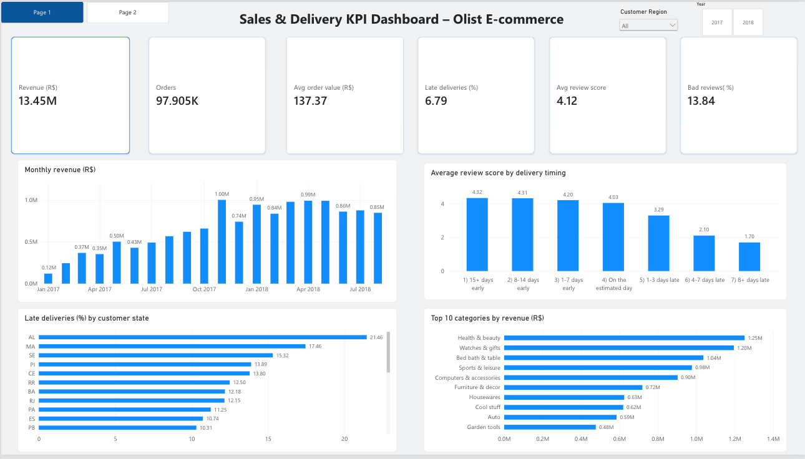
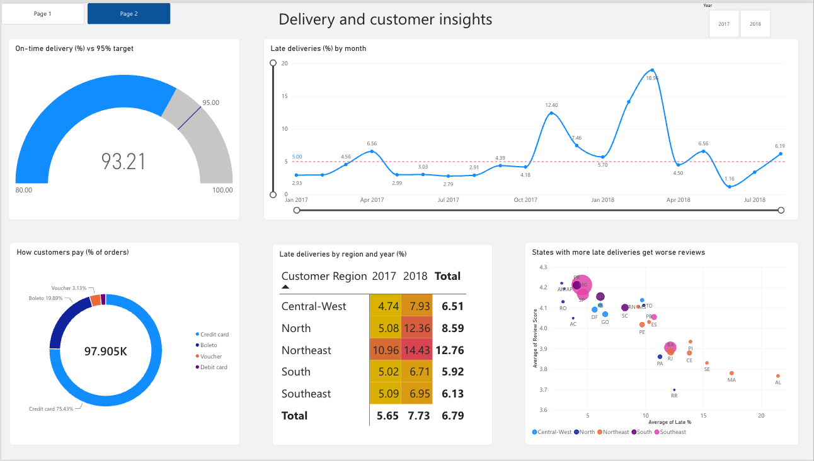
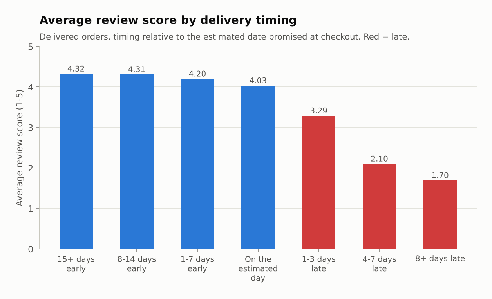
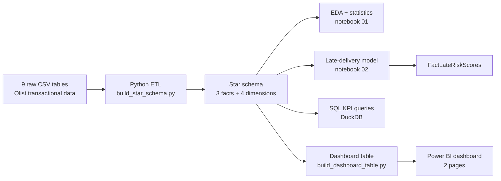
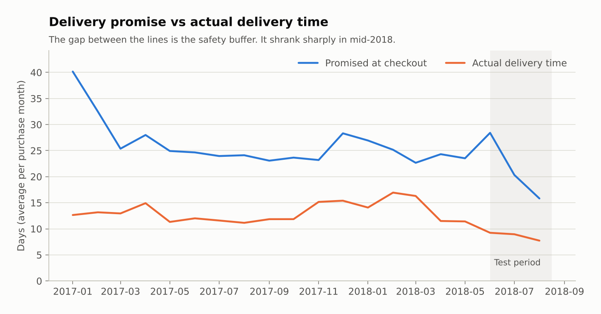
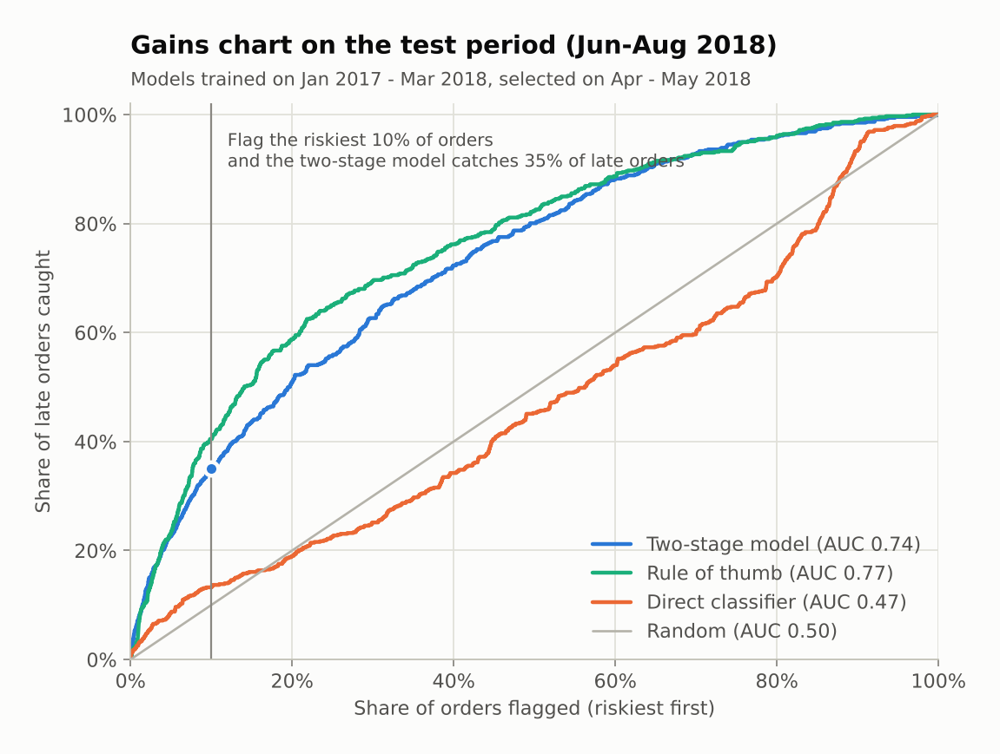

# Olist E-commerce: Sales & Delivery KPI Dashboard in Power BI, with Late-Delivery Prediction

End-to-end analytics project on **99,000 real orders** from Olist, a Brazilian e-commerce marketplace (2017–2018):
Python ETL into a **star schema**, an interactive **2-page Power BI KPI dashboard**, SQL versions of the core KPIs,
statistical testing, and a **machine learning model** that flags orders likely to arrive late, evaluated honestly on future data.

> **Headline finding:** a late delivery makes a 1–2 star review **6.7x more likely** (62% vs 9%), and the late rate **doubled** from 3.5% to 7.7%
> while order volume grew 137%. A delivery-time model can flag, at checkout, the 10% of orders that contain **35% of all late deliveries**.

## Power BI dashboard

Built in the Power BI service on 97,905 sold orders. Two pages linked by navigation buttons, with year and customer-region slicers.

**Page 1 – Sales and delivery overview:** six KPI cards (revenue, orders, average order value, late-delivery rate, average review, bad-review rate),
monthly revenue, review score by delivery timing, late-delivery rate by state, and the top 10 categories by revenue.



**Page 2 – Delivery and customer insights:** on-time rate against a 95% target (gauge), monthly late rate against a 5% target line,
payment mix, a region × year late-rate heatmap (conditional formatting), and late rate vs average review by state (scatter).



The card values match the Python calculation (revenue R$13.45M, 97,905 orders, 6.79% late, 93.21% on time, average review 4.12, 13.84% bad reviews).

**Data source:** [`olist_dashboard_data.csv`](olist_dashboard_data.csv) in the repository root, one row per sold order, built by
`src/build_dashboard_table.py` and loaded into Power BI from its raw GitHub URL.

## Business questions

1. How fast is the marketplace growing, and what drives the growth?
2. How good is the delivery experience, and how much does it affect customer satisfaction?
3. Where and when do late deliveries happen?
4. Can we predict late deliveries at checkout, early enough to act?

## Key findings

| # | Finding | Evidence |
|---|---|---|
| 1 | **Revenue grew +138% year over year** (Jan–Aug 2018 vs Jan–Aug 2017), driven by order volume; average order value was flat (+0.4%). | R$3.08M → R$7.34M; 22,562 → 53,530 orders |
| 2 | **Delivery did not scale with growth.** The late-delivery rate rose from 3.5% to 7.7% over the same period, with spikes after Black Friday (12.4%) and in March 2018 (19.0%). | `images/04_late_rate_by_month.png` |
| 3 | **Late delivery is the main driver of bad reviews.** Late orders average 2.27 stars vs 4.29 on time; 62.4% of late orders get 1–2 stars vs 9.2% (Mann-Whitney and chi-square p < 0.001; the same pattern in all 5 regions). Orders 8+ days late average 1.70 stars. | `images/03_review_by_delivery_timing.png` |
| 4 | **Lateness is concentrated** in the Northeast (12.8% late vs 6.1% in the Southeast), in Rio de Janeiro, and on long routes (12% late above 2,000 km vs 4.5% under 100 km). | `images/05_late_rate_by_state.png` |
| 5 | **Customers punish broken promises, not slow delivery.** Across the 27 states, the late rate is strongly related to the average review (r = −0.86), while the average delivery time is much less so (r = −0.52): remote states with long but honest delivery estimates still get good reviews. | dashboard page 2 |
| 6 | **Almost every customer buys only once** (3.0% repeat rate), and the first order's experience does not change that. | notebook 01, section 5 |
| 7 | **Revenue is concentrated:** the top 10% of sellers generate 67% of revenue, the top 1% generate 26%. | SQL Q6 |



## Approach



### 1. Data cleaning and modeling

The raw data is normalised for transactions. `src/build_star_schema.py` turns it into a star schema with two fact tables at different grains
(order items for revenue, orders for delivery and satisfaction), a model-scores fact, and four conformed dimensions.
Data quality issues found and fixed include:

- `customer_id` is generated **per order**; the real person is `customer_unique_id`. Using the wrong one would put the repeat rate at 0%.
- 547 orders with duplicate reviews, 610 products without a category, free-text seller cities (one is an e-mail address).
- The delivery estimate is a date but delivery is a timestamp, so lateness is compared at date level (otherwise 8.1% instead of 6.8% late).
- 32-character hash IDs replaced by integer surrogate keys.

Full model, relationships and design decisions: [`docs/data_model.md`](docs/data_model.md).

### 2. KPIs and the dashboard

The dashboard reads one flat table at order grain: `src/build_dashboard_table.py` joins the star schema into one row per sold order.
Rate KPIs are stored as 0/100 flags, so the *average* of a flag in a visual is directly the rate (the average of the late flag is the late-delivery rate).

| KPI | Definition | Value | Target |
|---|---|---:|---:|
| Revenue | Sum of product value (freight excluded) | R$13.45M | |
| Orders | Distinct sold orders | 97,905 | |
| Average order value | Revenue / orders | R$137.37 | |
| Late-delivery rate | Share of delivered orders that arrived after the estimated date (compared at date level) | 6.79% | ≤ 5% |
| On-time rate | 100% − late-delivery rate | 93.21% | ≥ 95% |
| Average review | Mean review score (1–5) of reviewed orders | 4.12 | |
| Bad-review rate | Share of reviewed orders with 1–2 stars | 13.84% | |

Full definitions: [`docs/kpi_dictionary.md`](docs/kpi_dictionary.md).

**Star-schema version for Power BI Desktop:** `powerbi/measures.dax` holds a library of 61 DAX measures for the full star schema, with build steps in
[`powerbi/BUILD_GUIDE.md`](powerbi/BUILD_GUIDE.md) and validation queries (`powerbi/measures_query_view.dax`) that should reproduce
[`docs/kpi_expected_values.csv`](docs/kpi_expected_values.csv). Highlights:

- `Revenue PY`: same period last year, **cut at the last date with data**, so Jan–Aug 2018 is compared with Jan–Aug 2017, not all of 2017
- `Late Delivery Rate (Product View)`: `TREATAS` to slice order-level KPIs by product without a bidirectional relationship
- `Orders Delivered (by Delivery Date)`: role-playing date dimension with `USERELATIONSHIP`
- `Top 10% Sellers Revenue Share`: `ADDCOLUMNS` + `TOPN` concentration measure

### 3. Predicting late deliveries at checkout

**Setup:** only information available at purchase time; time-based split (train Jan 2017–Mar 2018, validation Apr–May 2018, test Jun–Aug 2018);
leakage-free seller history and recent-delivery-speed features (verified by brute-force recomputation).

**What went wrong first:** a LightGBM classifier on the late label scored ROC-AUC 0.70 on validation but **0.47 on test**. Diagnosis: in mid-2018 the
**delivery promises were cut sharply** (average promised window from about 24 days in April–May to 16 days in August 2018), consistent with a change in Olist's estimate policy. With tighter promises the risk pattern flipped:
before, long-distance orders were the risky ones; afterwards, short same-state deliveries were late more often. A classic case of **concept drift**, here most likely triggered by a business decision rather than by customers.



**Fix:** model what is stable. Stage 1, a LightGBM regression, predicts **delivery time** without using the promise. Stage 2 compares the prediction with the
promised date and turns the gap into a risk score (logistic calibration on the validation period).

| Test period (Jun–Aug 2018, 3.6% late) | ROC-AUC | PR-AUC | Late orders caught in riskiest 10% |
|---|---:|---:|---:|
| Direct classifier | 0.47 | 0.04 | 13% |
| Rule of thumb: promised days − recent delivery days to the state | 0.77 | 0.13 | 40% |
| **Two-stage model** (selected on validation) | **0.74** | **0.13** | **35% (3.5x lift)** |

The two-stage model was chosen because it was clearly best on validation (0.77 vs 0.69 for the rule). On test, the simple rule did slightly better,
which shows that comparing the promise with *recent* delivery speed is what survives the change in promises. In production I would ship the model,
keep the rule as a benchmark, and recalibrate monthly. Orders in the high-risk band were late 12.7% of the time vs 1.9% in the low band.



## Recommendations

1. **Make late-delivery rate and review score primary operational KPIs**, reviewed weekly by region and seller, with alert thresholds (5% / 10%).
2. **Use the risk score at checkout:** for the riskiest 10% of orders, expedite shipping or send a proactive message with a realistic date. Measure the effect with an A/B test.
3. **Re-check the promise policy.** Shorter promises may lift conversion, but late deliveries cost 2 stars on average. Use the stage-1 model to set estimates by route instead of cutting them across the board.
4. **Prioritise logistics in the Northeast** and Rio de Janeiro, where late rates are about twice the Southeast's.
5. **Manage the top sellers actively:** 10% of sellers carry two thirds of revenue; a seller scorecard (late rate, review score) is the natural next page for the dashboard.

## Repository structure

```
├── olist_dashboard_data.csv          # dashboard data: one row per sold order (Power BI loads it from its raw URL)
├── data/
│   ├── raw/                          # 9 source CSVs (download with src/get_raw_data.py, not committed)
│   └── processed/                    # star schema CSVs
├── docs/
│   ├── data_model.md                 # schema, relationships, design decisions
│   ├── kpi_dictionary.md             # definition of every measure
│   ├── kpi_expected_values.csv       # reference KPI values from Python
│   └── model_metrics.json            # model results
├── images/                           # dashboard screenshots and analysis charts
├── notebooks/
│   ├── 01_eda_and_kpis.ipynb         # data quality, KPI validation, insights, statistical tests
│   └── 02_late_delivery_model.ipynb  # feature engineering, drift diagnosis, model, scores export
├── powerbi/
│   ├── BUILD_GUIDE.md                # star-schema build guide for Power BI Desktop
│   ├── measures.dax                  # 61 DAX measures for the star-schema version
│   ├── measures_query_view.dax       # same measures + validation queries
│   └── olist_theme.json              # report theme
├── sql/kpi_queries.sql               # 10 KPI queries (CTEs, window functions)
├── src/
│   ├── get_raw_data.py               # downloads the raw data
│   ├── build_star_schema.py          # ETL: raw tables -> star schema
│   ├── build_dashboard_table.py      # star schema -> flat dashboard table
│   ├── run_sql.py                    # runs the SQL queries with DuckDB
│   └── chart_style.py                # shared chart formatting
├── requirements.txt
└── .gitignore
```

## How to run

```bash
pip install -r requirements.txt
python src/get_raw_data.py          # ~120 MB from Olist's public GitHub repository
python src/build_star_schema.py     # writes data/processed/
python src/build_dashboard_table.py # writes olist_dashboard_data.csv for the dashboard
jupyter notebook notebooks/         # run 01, then 02 (02 writes FactLateRiskScores.csv)
python src/run_sql.py               # optional: the SQL versions of the KPIs
```

The dashboard was built in the Power BI service by loading `olist_dashboard_data.csv` from its raw GitHub URL.
For the star-schema version in Power BI Desktop, follow [`powerbi/BUILD_GUIDE.md`](powerbi/BUILD_GUIDE.md).

## Tools

Python (pandas, scikit-learn, LightGBM, SciPy, matplotlib) · Power BI (KPI cards, gauge, slicers, conditional formatting, page navigation) · DAX · SQL (DuckDB) · Jupyter

## Data

[Olist public dataset](https://github.com/olist/work-at-olist-data) (MIT licence), also published on Kaggle as *Brazilian E-Commerce Public Dataset by Olist*.
Olist originally released it as the take-home challenge for its own data science and analytics hires. Seller and customer identities are anonymised.
Analysis window: purchases from January 2017 to August 2018 (2016 and September–October 2018 contain too few orders to analyse).
