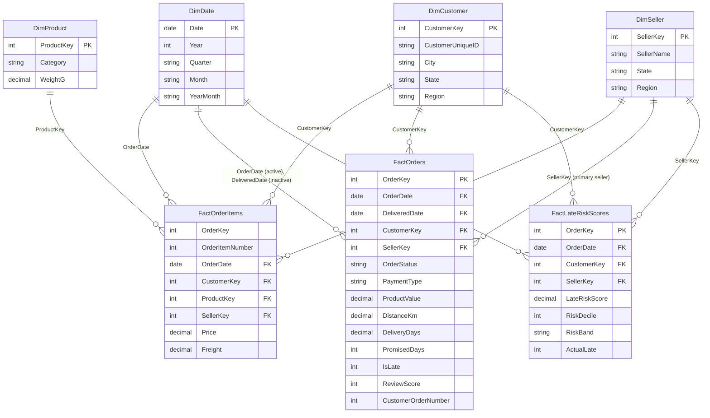

# Data model

A **star schema** with three fact tables at different grains and four shared (conformed) dimensions.
The raw data arrives as 9 normalised tables from Olist's transactional system; `src/build_star_schema.py` reshapes it for analysis.

## Tables

| Table | Grain | Rows | Purpose |
|---|---|---:|---|
| `FactOrderItems` | one row per item in an order | 111,752 | Revenue, product and seller analysis. Canceled/unavailable orders excluded. |
| `FactOrders` | one row per order | 99,092 | Delivery, satisfaction, payment, cancellation and retention KPIs. All statuses. |
| `FactLateRiskScores` | one row per scored order | 18,603 | Output of the late-delivery model for the test period (Jun–Aug 2018). |
| `DimDate` | one row per day, 2017-01-01 to 2018-12-31 | 730 | Calendar for time intelligence. Marked as the date table. |
| `DimCustomer` | one row per real customer | 95,774 | Location and first purchase date. |
| `DimProduct` | one row per product | 32,951 | English category names, weight, size. |
| `DimSeller` | one row per seller | 3,095 | Location and a readable label. |

## Relationships

All one-to-many, single direction (dimension filters fact).

| From (one side) | To (many side) | Active |
|---|---|---|
| `DimDate[Date]` | `FactOrderItems[OrderDate]` | yes |
| `DimDate[Date]` | `FactOrders[OrderDate]` | yes |
| `DimDate[Date]` | `FactOrders[DeliveredDate]` | **no** (used with `USERELATIONSHIP`) |
| `DimDate[Date]` | `FactLateRiskScores[OrderDate]` | yes |
| `DimCustomer[CustomerKey]` | `FactOrderItems`, `FactOrders`, `FactLateRiskScores` `[CustomerKey]` | yes |
| `DimSeller[SellerKey]` | `FactOrderItems`, `FactOrders`, `FactLateRiskScores` `[SellerKey]` | yes |
| `DimProduct[ProductKey]` | `FactOrderItems[ProductKey]` | yes |

## Design decisions (and the interview answer for each)

**Why a star schema instead of the original 9 tables?**
The source is normalised for transactions (writing one order at a time). Analysis needs fast filtering and aggregation. A star schema
gives one clear filter path from each dimension to each fact, simpler DAX and better compression in Power BI's VertiPaq engine.

**Why two fact tables (items and orders)?**
They have different grains. Revenue lives at item level (an order can have several products and sellers). Delivery, review and payment live at order level.
Putting order-level values on every item row would double-count them for multi-item orders (about 10% of orders). Facts with different grains belong in separate tables that share dimensions.

**Why integer surrogate keys?**
The source IDs are 32-character hashes. Integers compress far better in a column store, which makes the model smaller and faster, and they make joins cheaper in SQL as well.

**Why is `DimCustomer` keyed on `customer_unique_id`?**
In the source, `customer_id` is created per order. Using it would make every customer look like a one-time buyer and the repeat rate would be 0%.

**How are multi-seller orders linked to `DimSeller` in `FactOrders`?**
98.7% of orders have exactly one seller. For the rest, the order is assigned to its *primary seller* (largest share of order value).
Item-level seller analysis in `FactOrderItems` stays exact. This is a documented simplification, not a hidden one.

**How do product filters reach order-level KPIs (e.g. bad review rate by category)?**
`DimProduct` only filters `FactOrderItems`. Instead of a bidirectional relationship (which can create ambiguous filter paths and slow the model),
the `(Product View)` measures use `TREATAS` to pass the filtered order keys to `FactOrders` only where it is needed.

**Why an inactive relationship on `DeliveredDate`?**
`DimDate` is a *role-playing dimension*: orders can be analysed by purchase date (default) or delivery date (warehouse/carrier workload).
Power BI allows only one active path, so the second one is inactive and switched on inside a measure with `USERELATIONSHIP`.

**Why does `DimDate` cover full years 2017–2018?**
Time-intelligence functions (`SAMEPERIODLASTYEAR`, `TOTALYTD`) need a contiguous date table that covers complete years.
Because the data stops on 31 Aug 2018, the `PY` measures cut the comparison at the last date with data, so Jan–Aug 2018 is compared with Jan–Aug 2017.
